<div align="center">
  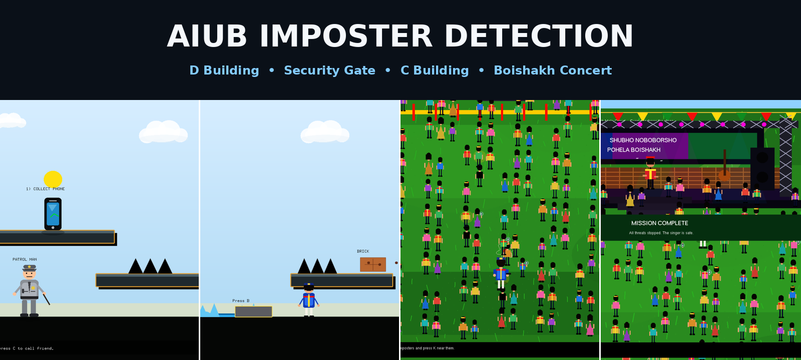

  <br>

  **C++ · OpenGL · FreeGLUT · Story-driven stealth game**
</div>

---

## Mission Route

<div align="center">
  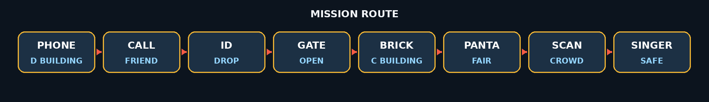
</div>

## Controls

| Move | Jump | Call | Interact | Brick | Knife | Gun | Day/Night | Restart |
|---|---|---|---|---|---|---|---|---|
| `A/D` or `←/→` | `W`, `↑`, `Space` | `C` | `E` | `B` | `K` | `G` | `N` | `R` |

## Story — In Order

### 1 · D Building — Get the ID

<p align="center">
  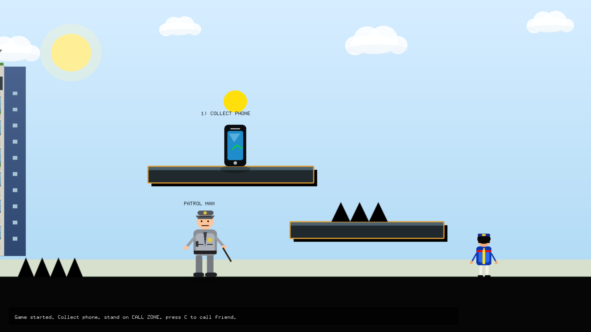
  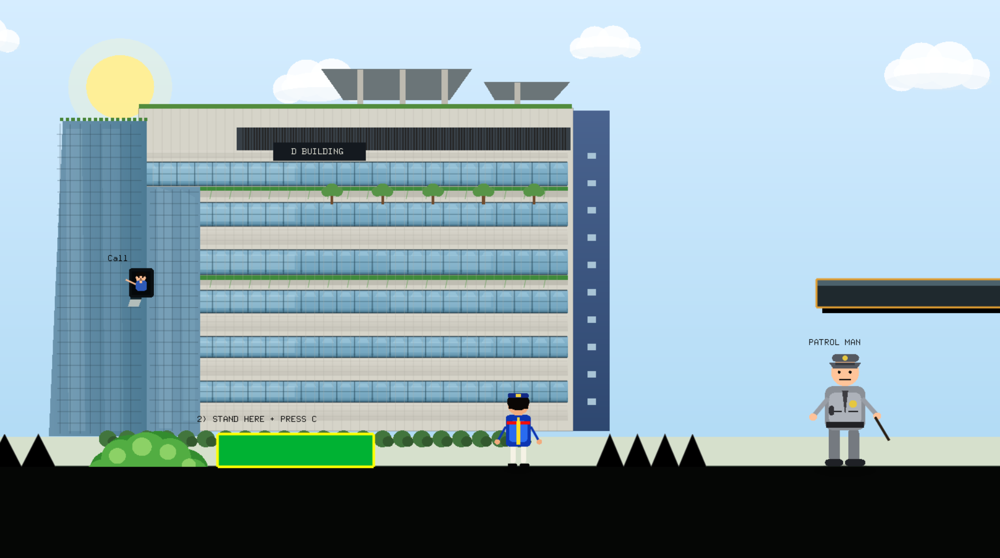
</p>
<p align="center"><b>Collect the phone</b> → <b>call the friend</b></p>

<p align="center">
  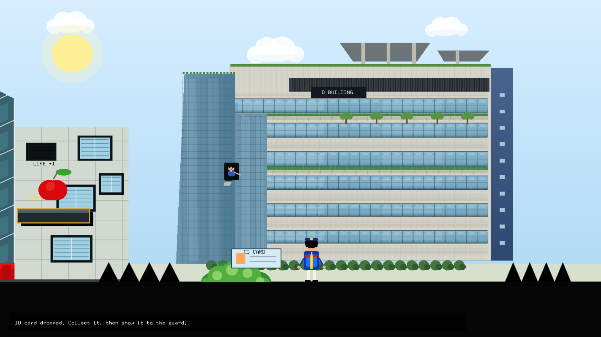
  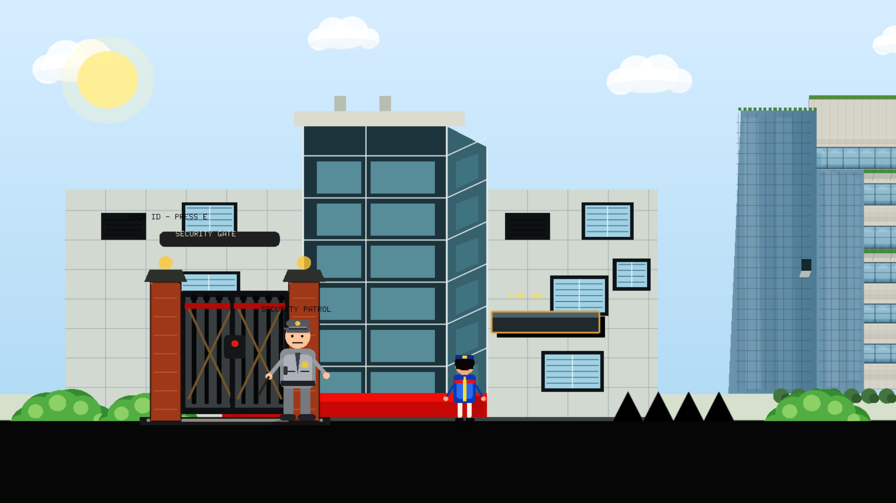
</p>
<p align="center"><b>Pick up the ID</b> → <b>reach security</b></p>

### 2 · Annex Gate & C Building — Prepare the Route

<p align="center">
  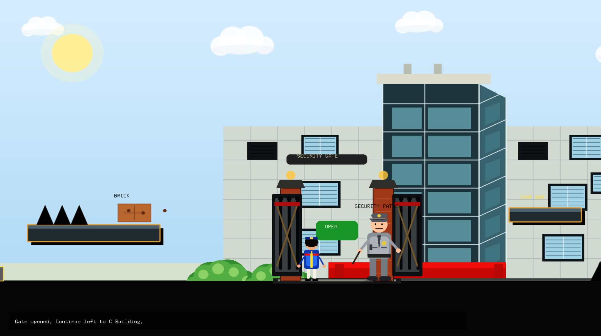
  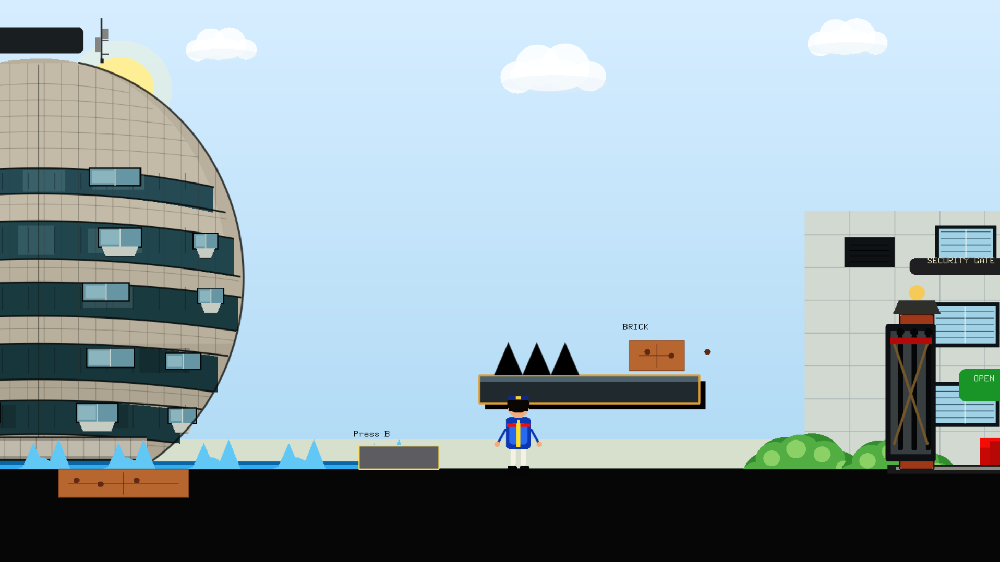
</p>
<p align="center"><b>Open the gate</b> → <b>find the bridge brick</b></p>

<p align="center">
  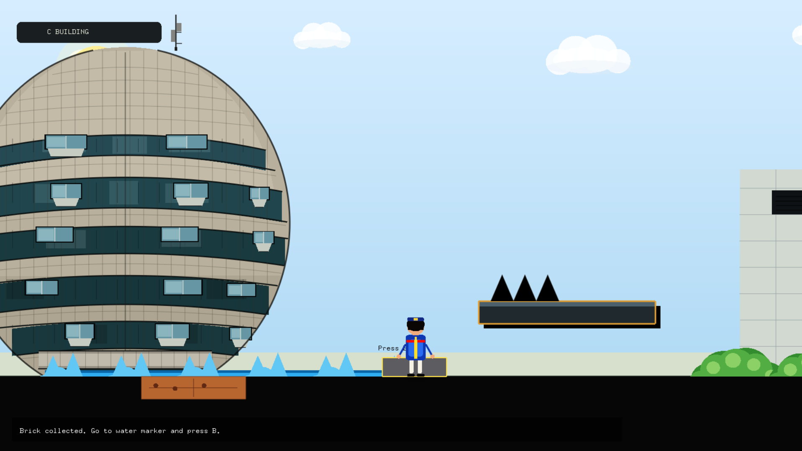
  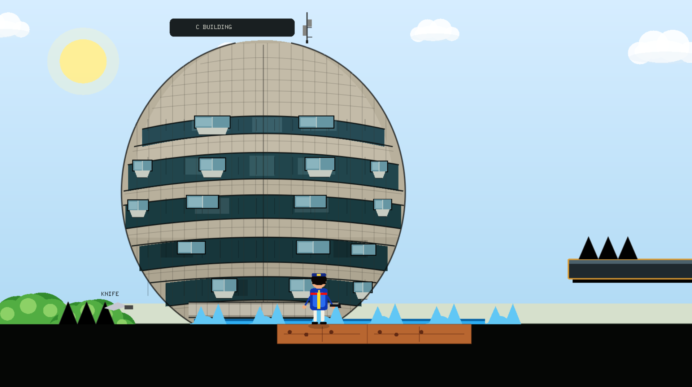
</p>
<p align="center"><b>Place the brick</b> → <b>cross the C Building hazard</b></p>

### 3 · Boishakh Concert — Detect the Imposters

<p align="center">
  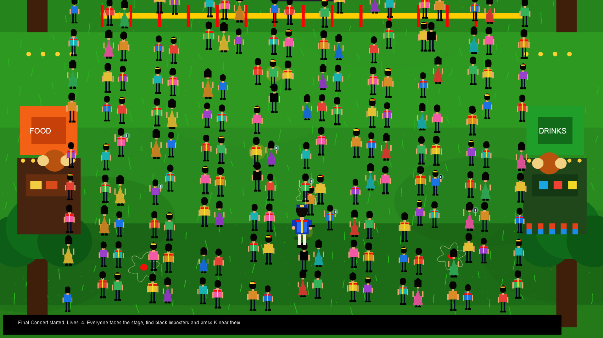
  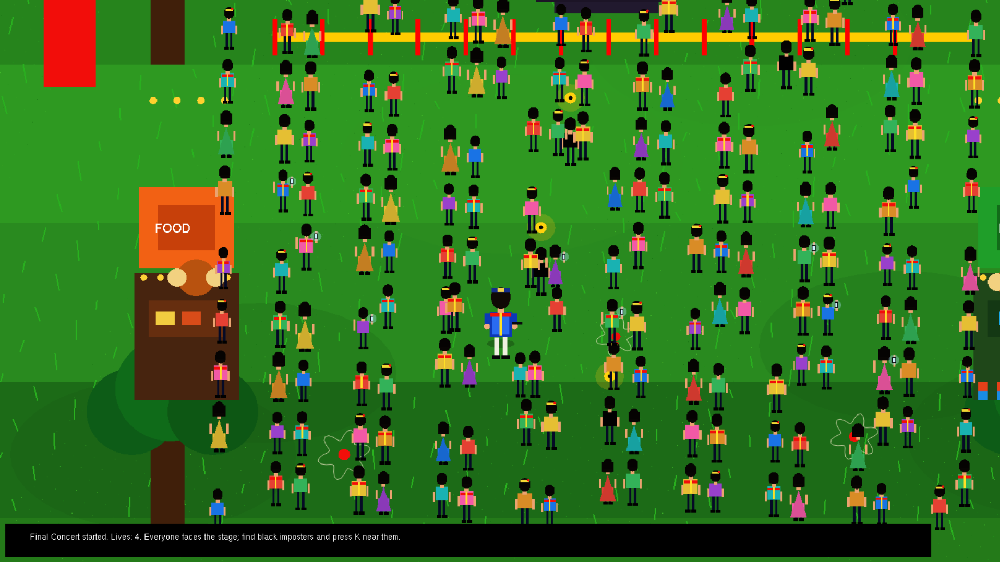
</p>
<p align="center"><b>Enter the concert</b> → <b>scan the crowd</b></p>

<p align="center">
  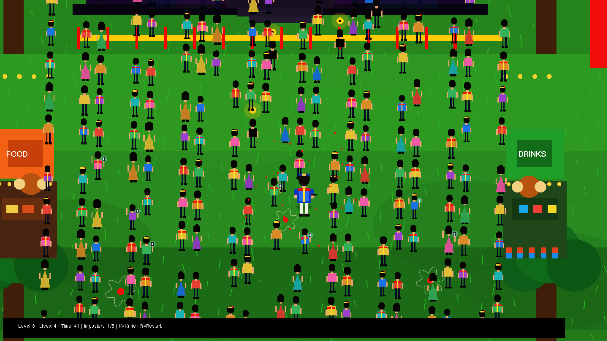
  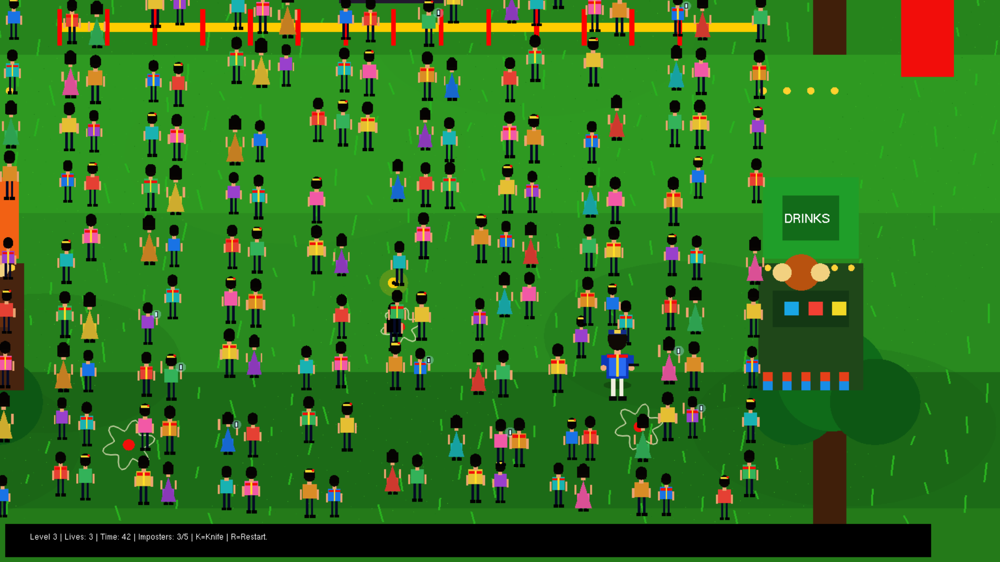
</p>
<p align="center"><b>Use the knife nearby</b> → <b>stop all five imposters</b></p>

<p align="center">
  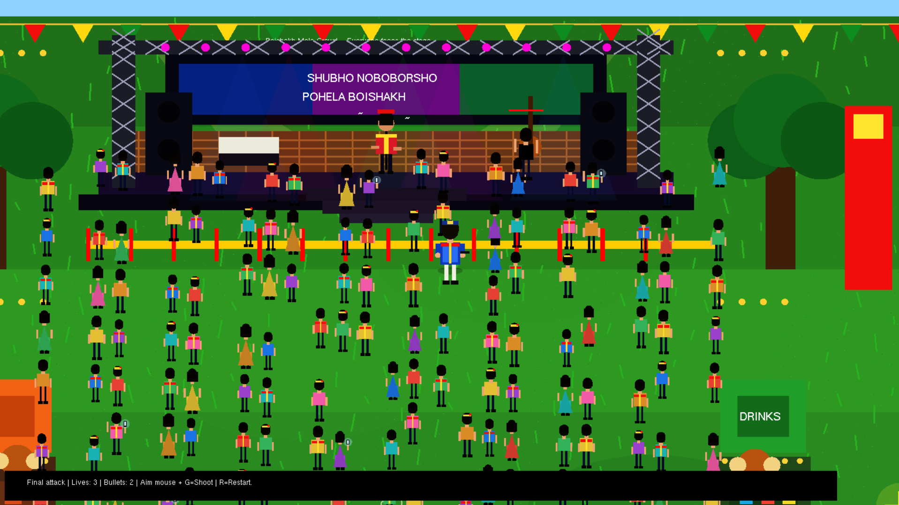
  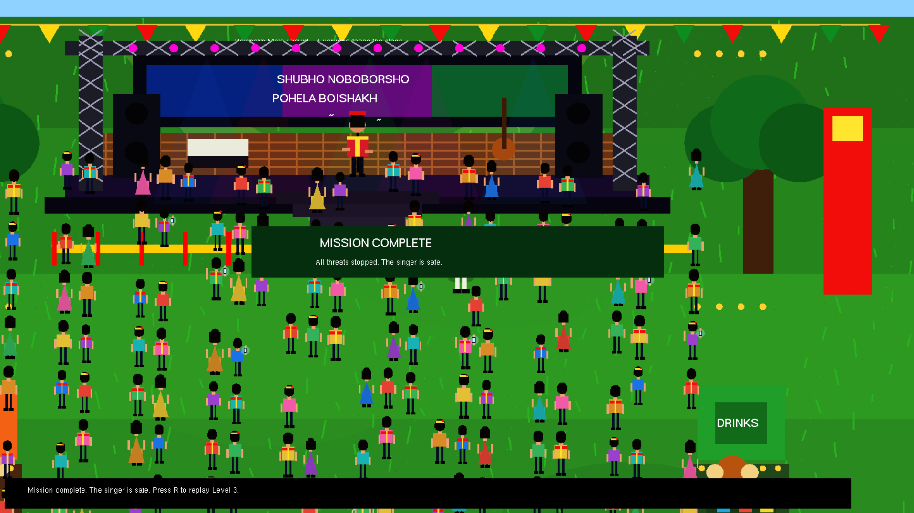
</p>
<p align="center"><b>Aim and shoot</b> → <b>save the singer</b></p>

## Run

### Windows — easiest

Extract the project, then **double-click `START_GAME.bat`**.

- If the game is already built, it starts immediately.
- If a compiler is installed with Code::Blocks/MinGW/MSYS2 but is not in `PATH`, the script detects it automatically.
- If no compiler/FreeGLUT toolchain is available, the script can install MSYS2 through Windows Package Manager (`winget`), install GCC + FreeGLUT, build the game, and then start it.

**Code::Blocks:** open `AIUB_Imposter_Detection.cbp`, then **Build and Run**.

**Manual Windows build:**

```bat
build_windows.bat
run_windows.bat
```

**CMake:**

```bash
cmake -S . -B build
cmake --build build
```

## Source Map

```text
src/main.cpp                         compilation root
src/modules/10_annex_building.inc   Annex / security complex
src/modules/20_d_building.inc       D Building + ID drop
src/modules/40_c_building.inc       C Building + water scene
src/modules/60_boishakh_fair.inc    Panta/fair transition
src/modules/80_final_concert.inc    crowd + imposters + final attack
src/all_in_one/...cpp               complete single-file version
```

**Code + maths:** [`docs/CODE_GUIDE.md`](docs/CODE_GUIDE.md)  
**Full story:** [`docs/STORY.md`](docs/STORY.md)
