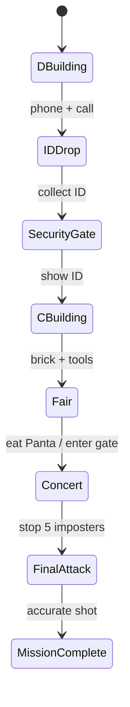

# Game Story

## AIUB Imposter Detection

A student arrives near **D Building** during Pohela Boishakh. A phone is waiting above the first hazard. After collecting it, the player reaches the call zone and contacts a friend inside D Building. The friend drops an ID card from a window.

The player collects the ID, avoids the patrol, and presents it at the **Annex security gate**. The gate opens toward **C Building**, where a brick must be recovered and placed beside the water to complete a safe crossing. The player then gathers the equipment required for the final mission.

The route continues through the **Boishakh fair and Panta Ilish scene** before reaching the concert. Five black-dressed imposters are hidden in the crowd. The player must identify and stop them before the timer expires. A final armed threat then appears near the stage; accurate mouse aim and the last shot save the singer.

## Story States

